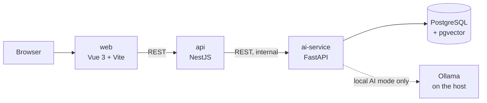

# AI Knowledge Assistant

Ask questions about a set of documents in natural language and get answers grounded in the retrieved passages, with references to the sources used.

> **Status: early development (Phase 1 of 5).**
> Only the repository foundation and the database container exist today.
> Everything under "Planned" below is not yet implemented. This README is updated as each part is built and verified.

## The problem

Sending a question straight to a language model gives you an answer with no way to check where it came from, and the model knows nothing about your own documents. This project implements **Retrieval-Augmented Generation (RAG)**: it first retrieves the relevant passages from a document collection, then asks a model to answer *only* from those passages and shows which passages it used.

The goal is a small but complete and honest application: retrieval, generation, references, tests, evaluation and a reproducible setup.

## Two run modes (planned)

| | **Demo mode** (default) | **Local AI mode** (optional) |
|---|---|---|
| Needs | Docker only | Docker + [Ollama](https://ollama.com) with downloaded models |
| Accounts / API keys | None | None |
| Retrieval | Keyword search (PostgreSQL full-text search) | Semantic search (embeddings + pgvector) |
| Answer | Extractive: the most relevant passages, shown as-is. **No language model is run.** | Generated by a local LLM from the retrieved passages |
| References | Yes | Yes |

The demo mode is labelled in the UI as non-AI. It does not imitate an LLM and does not present keyword search as semantic search.

## Architecture (planned)



| Component | Responsibility |
|---|---|
| `web` | Chat UI, source references, visible mode indicator. |
| `api` | Public API: request validation, error mapping, mode reporting, CORS and rate limits. The only service the browser talks to. |
| `ai-service` | Document ingestion and chunking, embeddings, retrieval, prompt/context building, answer generation, RAG evaluation. |
| `db` | Chunks, full-text index and vectors. |

Why two backends: the Python ecosystem is the natural home for document processing and LLM tooling, while the product-facing API is built in TypeScript. The boundary is explicit: `api` holds no retrieval logic and `ai-service` holds no HTTP-facing product concerns. Detailed decisions will be documented as the services are built.

## Stack

| Layer | Technology | Version |
|---|---|---|
| Database | PostgreSQL + pgvector (`pgvector/pgvector:0.8.7-pg18-trixie`) | PostgreSQL 18, pgvector 0.8.7 |
| Backend API | Node.js, NestJS, TypeScript, Vitest | Node 24 LTS, NestJS 12, TypeScript 6.0 |
| AI service | Python, FastAPI, Pydantic, pytest | Python 3.12 (planned) |
| Frontend | Vue 3, Vite, TypeScript | (planned) |
| Local LLM | Ollama | (planned) |

TypeScript is pinned to 6.0 because the NestJS 12 CLI requires `typescript ~6.0.2`.

## Getting started

### Prerequisites

- Docker with Docker Compose v2 (tested with Docker 29 / Compose 5 on OrbStack).
- Git.

### Run what exists today (database only)

```bash
git clone <repository-url>
cd ai-knowledge-assistant
cp .env.example .env
docker compose up -d
docker compose ps        # db should become "healthy"
```

Check that pgvector is enabled:

```bash
docker compose exec db psql -U knowledge -d knowledge -c "\dx vector"
```

Stop and remove everything, including the data volume:

```bash
docker compose down -v
```

The database port is bound to `127.0.0.1` only, on host port `5433` by default.

## Implemented

- Docker Compose service for PostgreSQL with the pgvector extension enabled on first start.
- Environment template (`.env.example`) with local-only placeholder values.
- NestJS project skeleton in [`api/`](api/) (generated by the Nest CLI; no application endpoints yet).

## Planned (not implemented yet)

- Sample documents (fictional content) and ingestion pipeline.
- Demo mode: full-text retrieval and extractive answers.
- Local AI mode: embeddings, vector retrieval and generation with Ollama.
- NestJS API and Vue chat UI with source references.
- Automated tests (Vitest, pytest) and a small RAG evaluation set.
- Screenshots, example questions, known limitations and security notes.

## Security notes

- No credentials are committed. `.env` is git-ignored; `.env.example` contains local-only placeholders.
- The database is published on `127.0.0.1` only.
- Further notes (input limits, prompt-injection risks from document content, local-only access) will be added with the features they apply to.

## License

To be decided.
